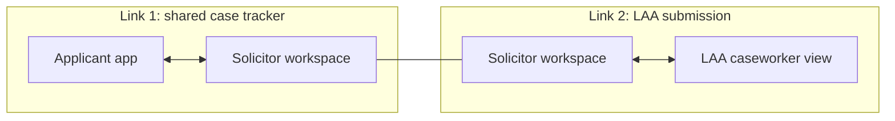

# 2. Solution overview

## 2.1 Summary

The service has three parts:

1. **Applicant app.** A safe, simple web app for the person applying. It works out which evidence they could get, lets them upload what they have, gives a gentle first check and keeps them up to date.
2. **Solicitor workspace.** Where the legal aid solicitor runs a full check on each document, fixes gaps, makes the Controlled Work decision or prepares the Licensed Work submission, and keeps the applicant informed.
3. **LAA caseworker view.** Where the caseworker receives Licensed Work submissions, runs an independent check, and decides to approve, refuse or return the application for more information.

A shared checking engine sits underneath all three. It compares a document with the requirements of a Schedule 1 paragraph and reports, requirement by requirement, what is met, what is not and why, with the supporting wording quoted from the document.

## 2.2 Three parts, two links

The solicitor is the hub. The two links are separate. Nothing moves from one link to the other unless the solicitor moves it.

### Link 1: applicant and solicitor

| | |
|---|---|
| Purpose | Collect the right evidence, and keep the applicant and solicitor working on the same case |
| Starts when | The case reference is created, by either the applicant or the solicitor |
| Reference used | The case reference, for example `LA-7K4-29Q` |
| What crosses | Uploaded documents, check results (in the right form for each party), tracker updates, messages, requests to evidence authors |
| Who controls it | The applicant decides which solicitor can join and can remove them. The solicitor decides what updates the applicant sees about the LAA stage |
| What never crosses | Nothing from link 2 reaches the applicant directly. The solicitor passes on updates |

### Link 2: solicitor and LAA

| | |
|---|---|
| Purpose | Submit a Licensed Work application with its evidence, handle requests for more information, and receive the decision. Also used if the LAA audits a Controlled Work file |
| Starts when | The solicitor submits |
| Reference used | The LAA's own application reference |
| What crosses | The evidence the solicitor relies on, the paragraph claimed, the completed checklist, the solicitor's notes, and the caseworker's decision or request |
| Who controls it | The solicitor chooses what to submit. The caseworker decides |
| What never crosses | The applicant's messages, evidence-finder answers, weaker or superseded documents, drafts, and the case reference |

### Why the solicitor is the hub

- **It matches how legal aid works.** The LAA's relationship is with the provider, not the applicant. The provider is accountable for what is submitted.
- **It protects the applicant.** Their private working with their solicitor stays on link 1. The LAA receives only what it needs to decide.
- **It keeps the solicitor accountable.** They choose the evidence and stand behind the submission, as they do today.
- **It is easier for MoJ to adopt.** Link 2 improves a channel that already exists between providers and the LAA, rather than adding a new relationship between the LAA and applicants.

## 2.3 References

| Reference | Created by | Created when | Used on | Seen by |
|---|---|---|---|---|
| Case reference | The service | When the applicant or solicitor starts the case | Link 1 | Applicant, solicitor |
| LAA application reference | The LAA | When the solicitor submits | Link 2 | Solicitor, LAA |

The solicitor workspace stores the link between the two references. The applicant never needs the LAA reference. The LAA never sees the case reference.

The case reference must not reveal anything about the case. Use a neutral format of letters and numbers, with no "DA" or similar prefix, so that it can sit in a text message or email without giving anything away.

## 2.4 Where the checking engine is used

The same engine runs at three points. The rules are the same each time. What changes is who sees the result and how it is presented.

| Where | Who sees the result | How it is presented |
|---|---|---|
| Applicant pre-check (link 1) | Applicant | Plain language only: "Looks complete" or "May need more detail, your solicitor will help". No legal reasoning, and never the word "rejected" |
| Solicitor check (link 1) | Solicitor | Full requirement-by-requirement checklist, quoted wording, flags, suggested paragraph, drafted follow-up requests |
| LAA independent check (link 2) | Caseworker | Full checklist on the submitted pack, plus a comparison with the solicitor's check. Any difference is flagged |

The LAA runs its own check rather than relying on the result the solicitor saw. This keeps the LAA's decision independent, and it means a solicitor cannot influence the outcome by editing what the tool told them.

How the engine works is set out in [07 Checking engine](07-checking-engine.md).

## 2.5 Design principles

1. **People make the decisions.** The service recommends, explains and drafts. It never approves or refuses on its own. Economic abuse (paragraph 21) always goes to a person, because the decision is the Director's discretion.
2. **Show the working.** A requirement can only be marked "met" if the service can point to the wording in the document that meets it. The quote appears next to the requirement so the reader can check it in seconds.
3. **The applicant's safety comes first.** Many applicants live with, or are monitored by, the person they are applying about. Every applicant-side feature is designed on the assumption that someone else may see their phone. See [09 Safety, privacy and security](09-safety-privacy-and-security.md).
4. **Only the minimum information crosses each link.** Each party sees what it needs for its job and nothing more.
5. **Judge substance, not form.** MoJ's accepted examples include typos and an unfilled template placeholder. The service should not reject evidence for cosmetic errors when the meaning is clear.
6. **One valid piece of evidence is enough.** The service looks for the strongest available route and stops asking for more once one document meets every requirement.
7. **Explain gaps in a way that leads to action.** Every gap comes with a next step: who to ask, what to ask for, and a drafted request.
8. **Build for reuse.** The requirements are kept as structured data, separate from the code, so that Schedule 2 and other evidence-based legal aid processes can be added without redesigning the service.

## 2.6 Scope

### Prototype (hackathon)

| Priority | Item |
|---|---|
| Must | Checking engine for all 22 Schedule 1 paragraphs, with quoted wording and pass, fail or refer outcomes |
| Must | Solicitor workspace: open a case, see the checklist per document, see flags and suggested paragraph, draft a follow-up request |
| Must | LAA caseworker view: queue, evidence view with quotes, approve, refuse or return, with a drafted return message |
| Must | Test results against the synthetic set and the MoJ examples |
| Should | Applicant app: safe entry, evidence finder, upload and plain-language result, as a clickable prototype at minimum |
| Should | Shared case tracker on link 1 with separate applicant and solicitor wording |
| Could | Comparison of solicitor and LAA check results |
| Could | Decision log and accuracy dashboard |

### After the hackathon

- Schedule 2 (protection of children)
- Integration with the LAA's application systems for link 2
- Checks on author registration (for example, GMC and NMC registers)
- Accessibility testing with users, translated applicant content, and testing with domestic abuse specialists
- A data protection impact assessment and security assessment before any real data is used

## 2.7 What the service does not do

- It does not approve or refuse legal aid. People do.
- It does not assess means or merits. Only the domestic abuse evidence requirement is in scope.
- It does not give the applicant legal advice. It explains what kinds of document exist and who can provide them, and leaves advice to the solicitor.
- It does not contact evidence authors without the solicitor's approval. It drafts. The solicitor sends.
- It does not confirm that a document is genuine. It flags anything that needs verifying, such as a missing professional registration number or a notice from outside the pilot areas.
