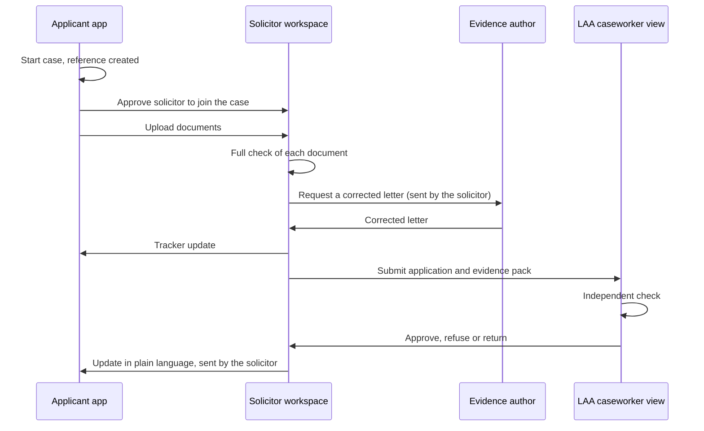

# 4. User flows

This document describes the journeys through the service, step by step. The applicant and solicitor share link 1. The solicitor and the LAA share link 2. See [02 Solution overview](02-solution-overview.md) for the structure.

## 4.1 End-to-end sequence (Licensed Work)

In Controlled Work the solicitor makes the decision, so the LAA steps do not happen unless the LAA later audits the file (see flow F).

## 4.2 Flow A: the applicant starts the case

| Step | What the applicant does | What the service does |
|---|---|---|
| A1 Safe entry | Opens the link | Shows a neutral start page with a quick-exit button. Explains in one line that nothing is saved on the phone |
| A2 Create case | Taps "Start" | Creates the case reference. Asks for a safe contact method (email, text, or "do not contact me") and safe times |
| A3 Evidence finder | Answers five or six yes/no questions | Asks about police involvement, a GP or hospital visit, contact with an IDVA or support service, refuge contact, council or housing association help, and court orders or undertakings |
| A4 Suggested routes | Reads the suggestions | Shows the two or three easiest routes. Each says who to ask, what to ask for, and links to the GOV.UK template letter where one exists. Explains that one strong document is enough |
| A5 Upload | Takes a photo or uploads a file | Runs the pre-check and shows a plain-language result (see 4.12) |
| A6 Share with solicitor | Enters or chooses her solicitor, or is pointed to GOV.UK "Find a legal aid adviser" | Sends a join request to the solicitor's firm. The solicitor joins only after the applicant approves |
| A7 Track | Signs in later with reference and one-time code | Shows the tracker in applicant wording |

## 4.3 Flow B: the solicitor starts the case

| Step | What the solicitor does | What the service does |
|---|---|---|
| B1 Create case | Creates a case for a new client | Creates the case reference |
| B2 Invite applicant | Sends the client a secure link through a contact the client says is safe | Applicant opens the link and goes through A1, then confirms she agrees to the firm having access |
| B3 Add documents | Uploads evidence the client has already given them | Runs the full check (flow C) and posts "document received" to the tracker |

## 4.4 Flow C: the solicitor's check

| Step | What the solicitor does | What the service does |
|---|---|---|
| C1 Open case | Opens the case from the dashboard | Shows the applicant's details, the other party's name, the application date, the work type, the documents and the tracker |
| C2 Confirm case details | Confirms or corrects the other party's name and the work type | Re-runs checks that depend on those details |
| C3 Review each document | Opens a document | Shows the matched paragraph, each requirement as met, not met or unclear, the quoted wording for each, and any flags |
| C4 Review the suggestion | Reads the overall result | Explains whether at least one document passes. If a document fits another paragraph better, suggests the switch |
| C5 Act on gaps | Chooses to fix a gap | Starts flow D |
| C6 Decide route | Selects Controlled Work or Licensed Work | Goes to flow E or flow F |

## 4.5 Flow D: fixing a gap

| Step | Who | What happens |
|---|---|---|
| D1 | Service | Drafts a request to the evidence author, naming the exact requirement. For example, for a hedged health letter: "Please confirm your professional judgement that the patient has injuries or a condition consistent with being a victim of domestic abuse, without qualification." Attaches the template where one exists |
| D2 | Solicitor | Edits if needed and sends it from their own email or post. The service records the date sent and sets a reminder |
| D3 | Service | Posts to the tracker. Applicant wording: "Your solicitor has asked your GP for an updated letter." |
| D4 | Solicitor or applicant | Uploads the new document when it arrives |
| D5 | Service | Checks the new version, links it to the old one as a replacement, and updates the tracker |

If the gap can only be fixed by the applicant, for example by asking a different professional, the service drafts a message to the applicant for the solicitor to approve.

## 4.6 Flow E: Controlled Work decision

| Step | Who | What happens |
|---|---|---|
| E1 | Solicitor | Confirms which document they rely on and makes the determination |
| E2 | Service | Produces a file note with the paragraph relied on, the checklist with quotes, the check date and the rules version. Stores the original document. This is the audit-ready file |
| E3 | Solicitor | Updates the applicant. The service suggests wording |

If the LAA later calls for the file, the solicitor sends the file note and evidence over link 2. The caseworker reviews it as in flow G.

## 4.7 Flow F: Licensed Work submission

| Step | Who | What happens |
|---|---|---|
| F1 | Solicitor | Selects the document or documents to rely on and the paragraph |
| F2 | Service | Builds the submission pack: the selected documents, the paragraph claimed, the checklist with quotes, the solicitor's notes, and for long documents the passage relied on |
| F3 | Solicitor | Reviews and submits. The LAA issues its own application reference |
| F4 | Service | Stores the link between the case reference and the LAA reference. Prompts the solicitor to update the applicant |

## 4.8 Flow G: caseworker review

| Step | What the caseworker does | What the service does |
|---|---|---|
| G1 Triage | Opens the queue | Sorts submissions into likely pass, needs review, and economic abuse. Flagged cases appear first. Nothing is approved automatically |
| G2 Open submission | Opens a case | Runs the independent check on the submitted pack. Shows the paragraph claimed, the checklist, the quotes highlighted in the document, any flags, and any difference from the solicitor's check |
| G3 Decide | Chooses approve, refuse or return | Asks for a reason. For a return, drafts the request (flow H) |
| G4 Record | Confirms | Logs the decision, the service's suggested outcome, and whether they matched |

## 4.9 Flow H: return for more information

| Step | Who | What happens |
|---|---|---|
| H1 | Service | Drafts the return message naming the paragraph and the requirement. For example: "The letter does not name the perpetrator, so it does not show the applicant sought refuge because of abuse by the other party (Schedule 1, paragraph 18)." |
| H2 | Caseworker | Edits if needed and sends over link 2 |
| H3 | Service | Shows the request in the solicitor's workspace against the case, and prompts the solicitor to update the applicant |
| H4 | Solicitor | Fixes the gap using flow D and resubmits under the same LAA reference |

## 4.10 Flow I: passing updates to the applicant

The two links stay separate. LAA events never reach the applicant automatically.

| LAA event | Prompt to solicitor | Suggested applicant wording |
|---|---|---|
| Submission received | "Let your client know the application has been sent?" | "Your application has been sent to the Legal Aid Agency." |
| Returned for information | "Let your client know what is happening?" | "The Legal Aid Agency needs one more thing. Your solicitor is dealing with it." |
| Decision made | "Contact your client about the decision" | "A decision has been made. Your solicitor will be in touch." |

Decisions are always explained to the applicant by the solicitor, not by a status change.

## 4.11 Flow J: changing or removing a solicitor

| Step | Who | What happens |
|---|---|---|
| J1 | Applicant | Chooses "Change solicitor" or "Remove solicitor" |
| J2 | Service | Ends the firm's access to link 1 from that point. The firm keeps the records it needs for its own legal and regulatory duties |
| J3 | Applicant | Can approve a new firm. The new firm sees the case from the point it joins, plus documents the applicant chooses to share |

## 4.12 Flow K: quick exit

| Step | What happens |
|---|---|
| K1 | The applicant taps the quick-exit button, or presses Escape three times on a keyboard |
| K2 | The page is replaced immediately with a neutral website, and the session ends |
| K3 | Signing in again needs the reference and a new one-time code |

## 4.13 What the applicant sees at each point

| Situation | Message |
|---|---|
| Document meets every requirement | "Thank you. This document looks complete. Your solicitor will check it." |
| Document has a gap the author can fix | "This document may need a little more detail. Your solicitor will help you get it." |
| Document is unlikely to fit any route | "This document may not be the right kind for legal aid. Your solicitor will talk to you about other options." |
| Document could not be read | "We could not read this clearly. You could try another photo in good light." |
| Nothing uploaded yet | "You do not need everything. One strong document is usually enough." |

The applicant never sees the words "rejected", "fail" or "not a victim", and never sees requirement-level legal reasoning.
