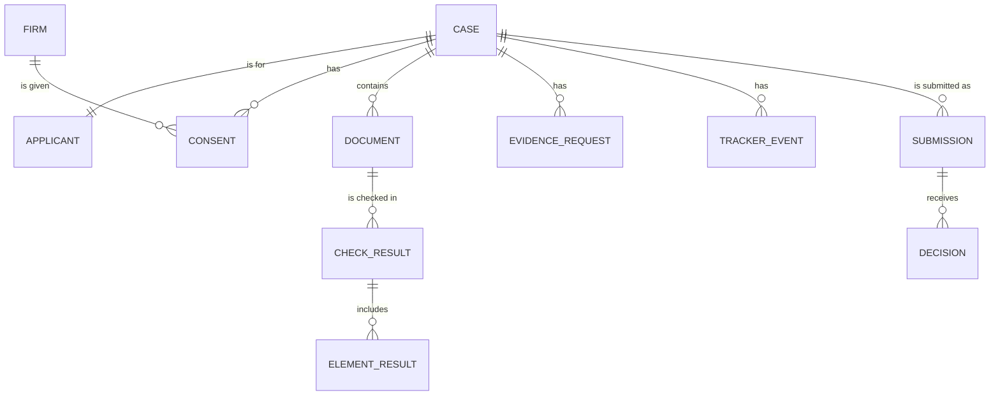

# 8. Data model and access

## 8.1 Records

| Record | Key fields | Link |
|---|---|---|
| Case | case_ref, created_at, created_by (applicant or solicitor), work_type, other_party_name, proceedings_type, status | 1 |
| Applicant | applicant_id, full_name, date_of_birth, safe_contact_method, safe_contact_value, safe_times | 1 |
| Firm | firm_id, firm_name, laa_account_number, verified | 1 and 2 |
| Consent | case_ref, firm_id, granted_at, withdrawn_at | 1 |
| Document | doc_id, case_ref, uploaded_by, received_at, file_type, author_organisation, replaces_doc_id, text_quality | 1 |
| Check result | check_id, doc_id, run_by (pre-check, solicitor or LAA), claimed_para, matched_para, outcome, reason, recategorise_to, rules_version, checked_at | 1 or 2 |
| Element result | check_id, element_key, status, quote, explanation | 1 or 2 |
| Evidence request | request_id, case_ref, doc_id, recipient, drafted_text, approved_by, sent_at, reminder_at, status | 1 |
| Tracker event | event_id, case_ref, event_type, applicant_text, solicitor_text, visible_to_applicant, created_by, created_at | 1 |
| Submission | submission_id, case_ref (held by the firm only), laa_ref, firm_id, para_relied_on, doc_ids, checklist_snapshot, solicitor_notes, submitted_at | 2 |
| Decision | decision_id, submission_id, caseworker_id, decision (approve, refuse or return), reasons, return_request_text, suggested_outcome, matched_suggestion, decided_at | 2 |
| Audit log | event_id, actor, action, record, timestamp | Both |

## 8.2 References

| Reference | Format | Rules |
|---|---|---|
| case_ref | Neutral letters and numbers, for example `LA-7K4-29Q` | Reveals nothing about the case. Never sent to the LAA |
| laa_ref | Issued by the LAA | Held by the firm against the case. Never shown to the applicant |

## 8.3 Who can see what

| Information | Applicant | Solicitor (linked firm) | LAA caseworker |
|---|---|---|---|
| Applicant's safe contact details | Yes | Yes | No |
| Evidence-finder answers | Yes | Yes | No |
| All uploaded documents | Yes | Yes | No, only those submitted |
| Applicant pre-check message | Yes | Yes | No |
| Solicitor check (full checklist) | No | Yes | No, the LAA runs its own |
| Evidence requests to authors | Status only | Yes | No |
| Tracker | Applicant wording | Solicitor wording | No |
| Messages between applicant and solicitor | Yes | Yes | No |
| Submission pack | No | Yes | Yes |
| LAA independent check | No | Summary of any difference | Yes |
| Caseworker decision and reasons | Through the solicitor | Yes | Yes |
| case_ref | Yes | Yes | No |
| laa_ref | No | Yes | Yes |
| Audit log | Own actions | Firm's actions on the case | LAA actions on the submission |

## 8.4 Retention

Retention periods must be agreed with MoJ and the LAA before any live use, and must be consistent with providers' existing record-keeping duties. As a starting point for discussion:

- Link 1 data is deleted a set period after the case closes, unless the firm has a duty to keep it.
- Controlled Work audit packs are kept for as long as the LAA can audit the claim.
- Superseded documents are deleted once a replacement has been accepted, unless the solicitor marks them to keep.
