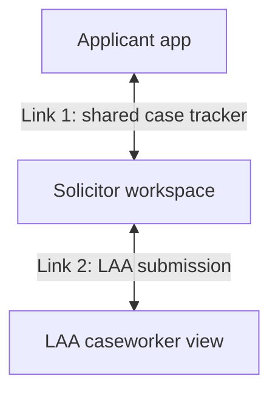

# Domestic Abuse Gateway evidence checker

A prototype service for checking domestic abuse evidence in civil legal aid applications for private family law in England and Wales.

It is designed around the three people involved in an application:

- the person applying for legal aid
- their legal aid solicitor
- the Legal Aid Agency (LAA) caseworker who may review the application

The service checks each piece of evidence against the requirements in Schedule 1 to the Civil Legal Aid (Procedure) Regulations 2012 and the LAA's published guidance. For each document, it:

- shows which requirements are met, quoting the wording that meets them
- explains anything that is missing or unclear
- drafts the follow-up request needed to fix it

Every funding decision stays with a person.

The prototype was built by MoJ Team 1 at the 10 Downing Street (10DS) hackathon on 5 and 6 October 2026, in response to the Ministry of Justice "Domestic Abuse Gateway" challenge.

> **Status:** hackathon prototype. Not for use with real cases or real personal data. All test data in this repository is fictional.

---

## The problem

Applicants for legal aid in private family law who rely on domestic abuse must provide one of a closed list of prescribed forms of evidence. Providers often submit evidence that is incomplete, placed in the wrong category, or missing.

The LAA then refuses the application or returns it for more information. This causes repeated exchanges, extra cost and delay, and more appeals, and it can hold up access to justice for people who are already vulnerable. Problems are usually found only at caseworker review, because nothing checks the evidence before submission.

MoJ asked for a tool that:

- reviews the evidence against the Gateway requirements
- shows what is satisfied
- flags missing or weak evidence and explains why
- produces a concise checklist for the provider and caseworker

The tool must support human decisions, not replace them.

See [01 Background](01-background.md) for the full context.

## How the service works



The service has three parts joined by two separate links, with the solicitor in the middle.

**Link 1** is between the applicant and their solicitor.
- A case reference is created at the very start, by either the applicant or the solicitor.
- Both then follow the case side by side in a shared tracker, seeing the same events in language suited to each of them.
- The applicant can find out which evidence to ask for, upload documents and get a gentle first check.

**Link 2** is between the solicitor and the LAA, and is completely separate.
- The solicitor decides what to submit.
- The workspace packages the chosen evidence with the paragraph relied on and a completed checklist.
- The caseworker runs an independent check on what arrives and decides whether to approve, refuse or return the application.

The applicant never sees the LAA side directly, and the caseworker never sees the applicant's private working on link 1.

See [02 Solution overview](02-solution-overview.md).

## Design principles

1. People make the decisions. The service recommends, explains and drafts. It never approves or refuses on its own.
2. Show the working. Every "met" result quotes the exact wording in the document that meets the requirement.
3. The applicant's safety comes first in every design choice on the applicant side.
4. Only the minimum information crosses each link.
5. Judge substance, not form. Typos and imperfect templates should not cause a rejection when the meaning is clear.
6. One valid piece of evidence is enough, so the service looks for the strongest route rather than demanding everything.
7. Build for reuse. The same approach should extend to Schedule 2 (child abuse evidence) and to other legal aid processes that rely on supporting documents.

## Documentation

| Document | What it covers |
|---|---|
| [01 Background](01-background.md) | Legal aid and the Domestic Abuse Gateway, Controlled and Licensed Work, what goes wrong today, what MoJ asked for, the data provided |
| [02 Solution overview](02-solution-overview.md) | The three parts and two links, references, where the checking engine is used, principles, scope |
| [03 Personas](03-personas.md) | The applicant, the solicitor, the LAA caseworker, and the people who write the evidence |
| [04 User flows](04-user-flows.md) | Step-by-step journeys for each persona, including the return loop and Controlled Work |
| [05 Use cases](05-use-cases.md) | 14 detailed use cases with triggers, flows, outcomes and matching test data |
| [06 Evidence requirements](06-evidence-requirements.md) | All 22 Schedule 1 forms of evidence, the cross-cutting rules, and lessons from the MoJ examples |
| [07 Checking engine](07-checking-engine.md) | How a document is checked, the outcomes, the output format, and the limits |
| [08 Data model and access](08-data-model-and-access.md) | Records, fields, references, and who can see what |
| [09 Safety, privacy and security](09-safety-privacy-and-security.md) | Applicant safety controls, data protection, security and accessibility |
| [10 Test data and evaluation](10-test-data-and-evaluation.md) | The synthetic and MoJ test sets, how labels work, and how we measure accuracy |
| [11 Demo plan](11-demo-plan.md) | The demo story, timings and likely questions |
| [12 Open questions and risks](12-open-questions-and-risks.md) | What we need MoJ to confirm, and the main risks with mitigations |
| [13 Glossary](13-glossary.md) | Terms and abbreviations |

## Working with the test data

These commands assume the generator is at `scripts/generate_da_evidence.py` and the data files are in `data/`. The generator needs Python 3.9 or later and no extra packages.

```bash
# Regenerate the standard set (same output every time with the default seed)
python3 scripts/generate_da_evidence.py --out data/synthetic_cases.json

# Make a fresh batch with different names and wording, and more valid examples per paragraph
python3 scripts/generate_da_evidence.py --seed 7 --valid 4 --out data/extra_cases.json
```

Each case contains the application details, one or more documents, and the expected result for each document and each requirement. The format is described in [10 Test data and evaluation](10-test-data-and-evaluation.md).

## Sources

- Legal Aid, Sentencing and Punishment of Offenders Act 2012
- The Civil Legal Aid (Procedure) Regulations 2012, regulation 33 and Schedule 1: <https://www.legislation.gov.uk/uksi/2012/3098/schedule/1>
- Legal Aid Agency, *Evidence Requirements for Private Family Law Matters*, version 15, 15 June 2026: <https://assets.publishing.service.gov.uk/media/6a3122bae50716856ed4b160/Evidence_requirements_for_private_family_law_matters_guidance_version_15_15_June_2026.pdf>
- GOV.UK sample letters to get evidence of domestic abuse: <https://www.gov.uk/government/collections/sample-letters-to-get-evidence-of-domestic-violence>
- GOV.UK list of domestic abuse and child abuse offences: <https://www.gov.uk/government/publications/domestic-violence-and-child-abuse-offences>
- Ministry of Justice hackathon pack: problem statement, use case and evidence examples (29 September 2026)

## Team

MoJ Team 1: Tirth Kanani, Zahid Mahmood, Jocelyn D'Arcy.
